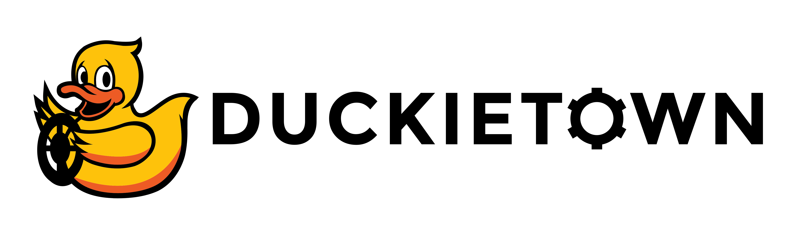

<p align="center">
<a href="https://duckietown.com"></a>
</p>

# **Learning Experience (LX): <LX_TITLE_HERE>**

Find the instructions to run this LX on the Duckietown Manual: [](<add link to LX instructions on manual>).

Supported LXs for Duckiebots are available at: [](https://docs.duckietown.com/ente/duckietown-manual/60-learning-experiences/lx-general-procedure.html) 

# About these learning activities

<DESCRIPTION_HERE>

In this learning experience, you will ... 

**TODO: Describe the LX activities and outcome here**

This learning experience is provided by the Duckietown team and can be run on Duckiebots. Visit us at the 
[Duckietown Website](https://www.duckietown.com) for more learning materials, documentation, and demos.

For guided setup instructions, lecture content, and more related to this LX, see [our massive open online course "Self-Driving Cars with Duckietown"](https://duckietown.com/self-driving-cars-with-duckietown-mooc/).

## Grading challenge

**TODO: Add optional challenge link or remove the `Grading challenge` section**

# General instructions

Make sure you have a functional [Duckietown Shell installation](https://docs.duckietown.com/ente/duckietown-manual/10-setup/02-software/duckietown-shell-dts-installation.html). 

**TODO: Update Step 1. to match your learner setup**

**NOTE:** All commands below are intended to be executed from the root directory of this exercise (i.e., the directory containing this README).

## 1. Make sure your LX is up-to-date

Update your LX definition and instructions,

    git remote add upstream git@github.com:duckietown/[lx-repo-name]
    
    git pull upstream <your upstream branch> [ente]

## 2. Make sure your system is up-to-date

- 💻 This is an `ente` learning experience (note the branch name). Make sure your Duckietown Shell is set to an `ente` profile 

- (and not, e.g., a `daffy` one). You can check your current distribution with

    dts profile list

  To switch to an ente profile, follow the [Duckietown Manual DTS installation instructions](https://docs.duckietown.com/ente/duckietown-manual/10-setup/02-software/duckietown-shell-dts-installation.html#dt-account-switch-profile).

- 💻 Always make sure your Duckietown Shell is updated to the latest version: `pipx upgrade duckietown-shell` (see the [installation instructions](https://github.com/duckietown/duckietown-shell)).

- 💻 Update the shell commands: `dts update`

- 💻 Update your laptop/desktop: `dts desktop update`

- 🚙 Update your Duckiebot: `dts duckiebot update ROBOTNAME` (where `ROBOTNAME` is the name of your Duckiebot - real or virtual.)

**Note**: if your virtual robot hangs indefinitely when you try to update it, you can try to restart it with:

    dts duckiebot virtual restart ROBOTNAME

## 3. Work on the exercise

### Launch the code editor

#### SSL certificate

If you have not done so already, set up your local SSL certificate needed to run the learning experience editor with:

    sudo apt install libnss3-tools
    dts setup mkcert

Open the code editor by running the following command,

```
dts code editor
```

Wait for a URL to appear on the terminal, then click on it or copy-paste it in the address bar
of your browser to access the code editor. The first thing you will see in the code editor is
this same document, you can continue there.

**NOTE**: if you are running Duckietown inside a devcontainer, make sure to [install the certificate for your host machine as well](https://docs.duckietown.com/ente/duckietown-manual/10-setup/00-computer/setup-duckietown-workspace.html#running-dts-code-editor). 

### Walkthrough of notebooks

**NOTE**: You should be reading this from inside the code editor in your browser.

Inside the code editor, use the navigator sidebar on the left-hand side to navigate to the
`notebooks` directory and open the first notebook.

Follow the instructions on the notebook and work through the notebooks in sequence.

### Building your code

You can build your code with 

```
dts code build -R ROBOT_NAME [--local]
```

This will build a Docker image with your code inside.

If `ROBOT_NAME` is a **real** Duckiebot, the image is built on the Duckiebot itself. This works, but it is slow
(the robot has to download and install all the dependencies). Add the `--local` flag to build the image on your
laptop instead: this is the recommended (and much faster) option. The flag is not needed for a virtual robot.

### Testing with the Duckiematrix

To test your code in the [Duckiematrix](https://docs.duckietown.com/ente/duckietown-manual/50-duckiematrix/introduction-to-the-duckiematrix-virtual-environment.html) you will need a virtual robot. You can create one with the command:

```
dts duckiebot virtual create --type duckiebot --configuration DB21J VBOT
```

where `VBOT` is the hostname. It can be anything you like, with [some constraints](https://docs.duckietown.com/ente/duckietown-manual/10-setup/03-duckiebot/flashing-sd-card-duckiebot-initialization-complete.html). Make sure to remember your robot (host)name for later.

Then you can start your virtual robot with the command:

```
dts duckiebot virtual start VBOT
```

You should see it with a status `Booting` and finally `Ready` if you look at `dts fleet discover`: 

```
     | Hardware |   Type    | Model |  Status  | Hostname 
---  | -------- | --------- | ----- | -------- | ---------
[VBOT] |  virtual | duckiebot | DB21J |  Ready   | [VBOT].local
```

Now that your virtual robot is ready, you can start the Duckiematrix. From a terminal in this exercise directory that you 
cloned do:

```
dts code start_matrix
```

You should see the Unity-based Duckiematrix simulator start up. The startup screen will look like:

[Insert nice LX picture here - e.g., Duckiematrix splashscreen for LX map - and a short description]

From here you can click anywhere on the window and click [ENTER] to make it become active. 

From here you can move the duckie towards the Duckiebot with the 'w', 'a', 's', and 'd' keys or you can move the camera angle to view the Duckiebot with the mouse. If you are close enough to your Duckiebot, you can jump on with the 'E' key, which should look like

**[Insert LX picture here and a short description]**

You can then drive the Duckiebot around with the 'w', 'a', 's', and 'd' keys. 

If you get very lost from the road and you want to come back, you can do so with the 'R' key.

You can also switch to a top-down (overhead) view with the 'V' key.


### 💻 Testing 


To test your code in the Duckiematrix you can do:

```
dts code workbench -m -R [VIRTUAL_ROBOT_NAME]
```

and to test your code on your real Duckiebot you can do:

```
dts code workbench -R [ROBOT_NAME]
```


**TODO: Describe what the learner should see while the workbench runs, or remove this note.** Prefer
interactive tools inside the notebooks (e.g., `ipywidgets` sliders and plots) over a separate desktop.

**Optional (ROS 1 LXs only):** if your recipe ships a `Dockerfile.vnc` with desktop tools such as RViz or
`rqt`, explain here what to look at, and tell the learner to launch the `noVNC` viewer in another terminal:

```
dts code vnc -R [ROBOT_NAME]
```

where `[ROBOT_NAME]` could be the real or the virtual robot (use whichever you ran the `dts code workbench` and `dts code build` command with).
Remove this paragraph if your recipe does not use the desktop.


Now you can proceed to the [first notebook](ADD_LINK_TO_NOTEBOOK).
